# CRATER CLASH
## Unity 6 — Mobile Game Menu UI/UX Lab

**Developer:** Tayyab Ahmed Minhas  
**Engine:** Unity 6  
**Reference resolution:** 1080 × 1920  
**Project:** `ITU-CS-464-LAB-07-BSCS25031`

**Release:** [Download Latest Release](https://github.com/ShadeHexSD/ITU-CS-464-LAB-07-BSCS25031/releases/tag/untagged-7b569cafeb297a566e5c)

> Crater Clash is a mobile arcade-game menu prototype. It contains ten connected menu/UI screens and a small gameplay placeholder used to demonstrate pausing and match results. The gameplay placeholder is not counted as one of the ten screens.

---

## Contents

1. [Project overview](#1-project-overview)
2. [Screen flow and navigation](#2-screen-flow-and-navigation)
3. [Visual design system](#3-visual-design-system)
4. [Motion and tween system](#4-motion-and-tween-system)
5. [Screen documentation](#5-screen-documentation)
   - [01 — Title](#01--title)
   - [02 — Main Menu](#02--main-menu)
   - [03 — Mode Select](#03--mode-select)
   - [04 — Level Select](#04--level-select)
   - [05 — Loadout](#05--loadout)
   - [06 — Shop](#06--shop)
   - [07 — Settings](#07--settings)
   - [08 — Pause](#08--pause)
   - [09 — Results](#09--results)
   - [10 — Credits](#10--credits)
6. [Responsive layout and accessibility](#responsive-layout-and-accessibility)
7. [Screenshots and annotation convention](#screenshots-and-annotation-convention)
8. [Demo video](#8-demo-video)
9. [Known limitations](#9-known-limitations)
10. [Credits and references](#10-credits-and-references)

---

# 1. Project overview

Crater Clash is a colourful arcade-style mobile game interface. The visual direction uses a deep-indigo base, raised violet panels, thick dark outlines and bright accent colours. The menu system is designed around a clear primary action, repeatable card/button patterns and predictable back navigation.

### Screens included

| # | Screen | Purpose |
|---:|---|---|
| 01 | Title | Introduces the game and starts the menu flow |
| 02 | Main Menu | Central hub for Play, Brawlers, Shop and Settings |
| 03 | Mode Select | Chooses a game mode |
| 04 | Level Select | Chooses a map and displays progress/locked states |
| 05 | Loadout | Selects a brawler and compares stats |
| 06 | Shop | Purchases demo items with coins and gems |
| 07 | Settings | Toggles preferences and opens Credits |
| 08 | Pause | Resumes, restarts or quits a match |
| 09 | Results | Shows victory, stars and rewards |
| 10 | Credits | Credits the developer and visual reference |

A separate **Gameplay placeholder** (`Screen_Match`) contains a countdown timer, Pause button and End Match button. It exists only to give Pause and Results a real navigation context; it is not one of the ten menu screens.

---

# 2. Screen flow and navigation

```text
                         ┌──────────────────┐
                         │    01 Title      │
                         └────────┬─────────┘
                                  │ Tap anywhere
                                  ▼
                         ┌──────────────────┐
             ┌──────────►│ 02 Main Menu     │◄──────────────┐
             │           └───┬────┬─────┬────┘               │
             │               │    │     │                    │
             │             Play Brawlers Shop              Quit
             │               │    │     │                    │
             │               ▼    ▼     ▼                    │
             │          ┌──────┐ ┌───────┐ ┌───────┐          │
             │          │03    │ │05     │ │06     │          │
             │          │Modes │ │Loadout│ │Shop   │          │
             │          └──┬───┘ └───┬───┘ └───────┘          │
             │             │         │                        │
             │             ▼         │                        │
             │          ┌──────┐      │                        │
             │          │04    │──────┘                        │
             │          │Levels│                               │
             │          └──┬───┘                               │
             │             │ Start match                       │
             │             ▼                                   │
             │       Gameplay placeholder                      │
             │          ┌───┴────┐                             │
             │        Pause    Results                          │
             │        ┌─┴─┐    ┌─┴────────┐                    │
             └────────┤Quit   Home     Next map ──► Levels      │
                      └───────┴─────────────────────────────────┘

Main Menu ── Settings ── Credits
                  ▲          │
                  └── Back ──┘
```

### Navigation table

| From | Action | Destination | Back / exit behaviour |
|---|---|---|---|
| Title | Tap anywhere | Main Menu | Title is not added to the back history |
| Main Menu | Play | Mode Select | Main Menu is the hub |
| Main Menu | Brawlers | Loadout | Back returns to Main Menu |
| Main Menu | Shop | Shop | Back returns to Main Menu |
| Main Menu | Settings | Settings | Back returns to Main Menu |
| Settings | Credits | Credits | Back returns to Settings |
| Mode Select | Choose any mode | Level Select | Back returns to Mode Select |
| Level Select | Choose an unlocked map | Loadout | Back returns to Level Select |
| Level Select | Start Match | Gameplay placeholder | Esc opens Pause |
| Loadout | Select | Previous screen | Uses the navigation history |
| Gameplay placeholder | Pause button / Esc | Pause | Resume or Esc closes Pause |
| Gameplay placeholder | End Match | Results | Results has explicit exits |
| Pause | Resume | Gameplay placeholder | Timer continues |
| Pause | Restart | Gameplay placeholder | Timer resets |
| Pause | Quit to Menu | Main Menu | Time scale is restored |
| Results | Next Map | Level Select | Rewinds to the previous level-selection context |
| Results | Home | Main Menu | Clears the navigation history |

The `ScreenManager` maintains a history stack for forward navigation and Back. It supports Push, Fade and Modal transitions. The Android Back key / Esc key is handled by the manager for screens that allow it. Match and Results ignore the generic back key because they have explicit exit actions.

---

# 3. Visual design system

## 3.1 Colour palette

The interface follows a **60–30–10** distribution: approximately 60% deep-indigo background, 30% violet cards/panels and 10% accent colours.

| Name | HEX | Intended use | Text / contrast guidance |
|---|---|---|---|
| Deep Indigo | `#2B1B72` | Main screen backgrounds | White; guide estimates about 14:1 |
| Violet | `#3D2A96` | Cards and panels | White; guide estimates about 12:1 |
| Midnight | `#0D0837` | Outlines, shadows and dark text | Used for dark edges and text on bright fills |
| Go Green | `#3DDC84` | Main forward action: Play, Start, Select, Resume, Next | Midnight; guide estimates about 10:1 |
| Sun Yellow | `#FFD23F` | Rewards, currency and highlighted titles | Midnight; guide estimates about 13:1 |
| Info Blue | `#3EA6FF` | Navigation and secondary actions | Midnight; guide estimates about 7:1 |
| Hot Pink | `#FF4F9A` | Shop actions and shop-specific elements | Midnight; guide estimates about 6:1 |
| Soft Purple | `#5A45B8` | Back buttons and quiet actions | White; guide estimates about 7:1 |
| Pale Lilac | `#D9D2FF` | Helper text on cards | On Violet; guide estimates about 7:1 |

**Colour rules**

- **One colour, one meaning:** green indicates the primary forward action; yellow indicates rewards/currency; pink is reserved for the Shop.
- **60–30–10:** keep indigo dominant, violet secondary and bright accents limited.
- **Value before hue:** dark outlines and shadows help components remain distinguishable in greyscale.
- **Never communicate by colour alone:** buttons have text labels, locked levels say “Locked”, and stars retain their shape.

## 3.2 Typography

**Font:** TextMeshPro default **LiberationSans SDF**, Bold. Outlined text uses the `LiberationSans SDF - Outline` material preset with Midnight outline colour `#0D0837` and thickness `0.25`.

All sizes below are specified at the 1080 × 1920 reference resolution.

| Role | Size | Colour / treatment |
|---|---:|---|
| Logo | 190 px | Sun Yellow, outlined |
| Screen title | 80 px | White, outlined |
| Button text | 64 px | Depends on button fill; normally Midnight |
| Card title | 60 px | White |
| Body text | 48 px | White |
| Small helper text | 40 px minimum | Pale Lilac |

## 3.3 Spacing, sizing and touch

- Spacing scale: **24, 36 and 60 px**.
- Standard screen side margin: **60 px**.
- Minimum tappable target: **144 × 144 px**.
- Primary actions: approximately **150–190 px** high.
- Place main actions in the bottom third where practical (thumb zone).
- Align related elements to shared edges and group related controls inside panels.
- Keep destructive/risky actions, such as Quit, visually and spatially separated from safe actions such as Resume.

---

# 4. Motion and tween system

The project uses a small in-house `Tween` helper; no tweening plugin is required. The helper supports `Linear`, `OutCubic`, `InCubic`, `OutExpo`, `OutBack` and `InOutQuad`. Tweens use **unscaled time**, so UI transitions can continue while gameplay is paused.

## 4.1 Global motion reference

| Moment | What moves | Ease | Duration | UX reason |
|---|---|---|---:|---|
| Open a deeper screen | New screen slides in from right; old screen drifts left and dims | OutExpo | 0.38 s | Communicates forward navigation with a quick start and soft landing |
| Go back | Same slide in reverse | OutExpo | 0.34 s | Preserves spatial direction and navigation context |
| Big jump (Title → Menu, Results) | New screen scales from 90% and fades in | OutBack | 0.42 s | Small overshoot adds emphasis to important transitions |
| Open Pause | Modal panel rises from bottom over a dim layer | OutBack | 0.42 s | Focuses attention while leaving the match visible |
| Close Pause | Panel drops and fades | InCubic | 0.28 s | Quickly removes the modal |
| Button press | Scale to 93%, then spring back | OutCubic down; OutBack up | 0.08 s / 0.28 s | Immediate tactile feedback and confirmation |
| Toggle | Knob slides and background colour changes | OutBack | 0.30 s | Makes the new state clear through position and colour |
| Brawler selection | Avatar grows; stat bars fill | OutBack; OutExpo | 0.30 s; 0.55 s | Shows selection and communicates stat differences |
| Locked level | Card shakes sideways and settles | Sine fade-out (linear tween progress) | 0.30 s | Gives a clear, non-threatening “not available” response |
| Results stars | Stars pop sequentially | OutBack | 0.45 s each; 0.22 s stagger | Builds the reward reveal in a readable order |
| Toast | Rises, remains visible, then drops | OutBack; InCubic | 0.30 s / 0.25 s | Confirms an action without blocking the interface |
| Title logo and prompt | Logo gently wobbles; prompt pulses alpha | Sine loop | Continuous | Draws attention to the single start action |
| Credits content | Content fades in and moves upward | OutCubic | 0.60 s | Calm entrance suited to supporting information |

## 4.2 Additional interaction feedback

| Interaction | Implementation value | Purpose |
|---|---|---|
| Currency label change | OutBack bounce, 0.35 s; scales from 125% to 100% | Makes updated currency noticeable |
| Shop price label | OutBack punch, 0.38 s; scales from 130% to 100% | Confirms purchase |
| Toast hold | 1.4 s using realtime wait | Leaves enough time to read feedback |
| Locked-card shake | 22 px horizontal distance, two swings | Makes the unavailable state noticeable |
| Toggle switch | 84 px travel in a 180 px control | Shows on/off position clearly |
| Brawler avatar | Selected avatar scales to 110% | Reinforces selected character |

---

# 5. Screen documentation

Each screen section contains its purpose, design decisions, interaction/navigation, tween details and screenshot references. Screenshot filenames follow the existing project folders:

- `screenshots/colour/`
- `screenshots/greyscale/`
- `screenshots/annotated/`

The colour files are the original screen captures supplied for this project, copied without recreating the UI. The greyscale files are desaturated copies of those originals. The annotated files retain the original screen image with numbered callouts; the extra top branding and footer copy have been removed. Keep the three versions of each screen aligned.

## 01 — Title

**Purpose:** Introduce Crater Clash and provide one obvious action to enter the Main Menu.

### Screenshots

| Version | Image |
|---|---|
| Annotated colour | 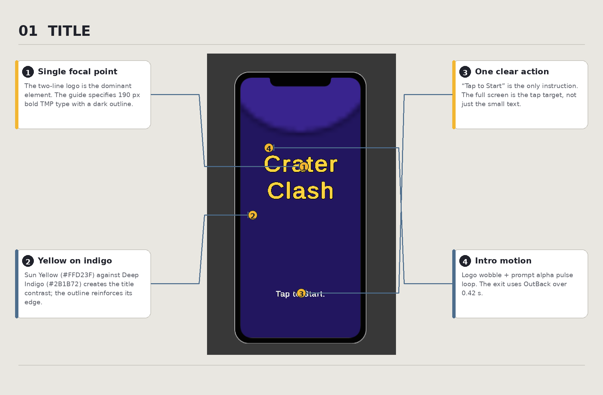 |
| Original colour | 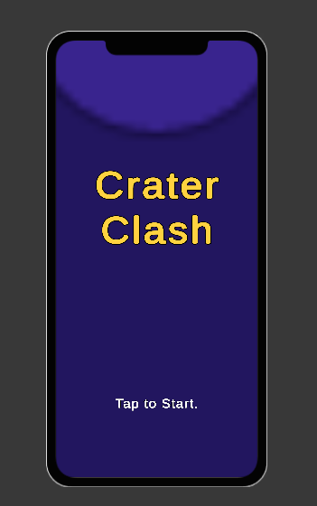 |
| Greyscale | 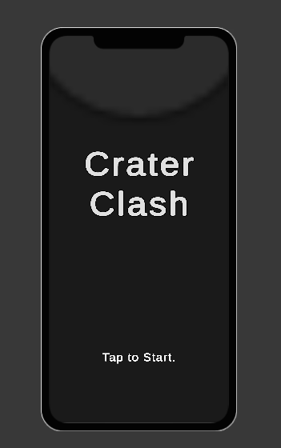 |

### Principles and techniques

- **Single focal point:** the two-line “CRATER / CLASH” logo is centred and uses 190 px bold Sun Yellow type with a Midnight outline.
- **Contrast:** yellow logo and white prompt sit against the Deep Indigo background.
- **Minimalism:** the screen contains one clear instruction, “Tap to start”, rather than several competing actions.
- **Affordance and touch target:** an invisible full-screen `TapCatcher` receives taps, so the whole screen acts as the start target.
- **Typography:** logo is 190 px; prompt is 64 px.
- **Spacing:** logo is positioned at Y `250`; prompt is anchored to the bottom with Y `300`.

### Tweens and motion

| What moves | Ease | Duration | Why |
|---|---|---:|---|
| Logo rotation, ±3 degrees, and scale pulse, ±3% | Sine loop | Continuous | Gentle motion attracts attention without competing with the title |
| “Tap to start” alpha pulse | Sine loop | Continuous | Repeatedly signals the only available action |
| Title → Main Menu transition | OutBack Fade | 0.42 s | Scales the destination from 90% while fading in to mark the start of the menu |

**Navigation:** Tap anywhere → Main Menu. The transition uses Home navigation and clears the history, so Back does not return to the Title screen.

**Greyscale review:** Check that the logo remains distinct through lightness and its dark outline, and that the prompt remains readable against the background. The action is also communicated by text and a full-screen tap area, not hue alone.

**Annotation callouts:** Mark the logo as the 190 px focal point; point to the pulsing prompt; note the yellow-on-indigo contrast; draw an arrow for the OutBack Fade entrance.

---

## 02 — Main Menu

**Purpose:** Act as the central hub and make Play the most prominent next action.

### Screenshots

| Version | Image |
|---|---|
| Annotated colour | 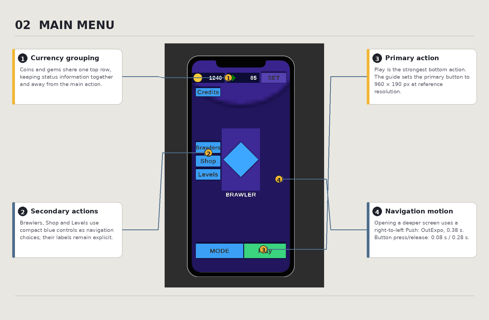 |
| Original colour | 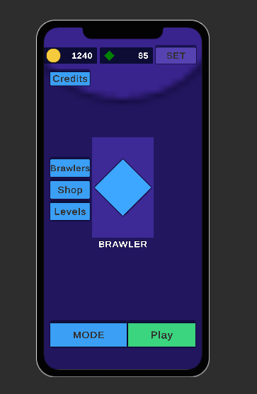 |
| Greyscale | 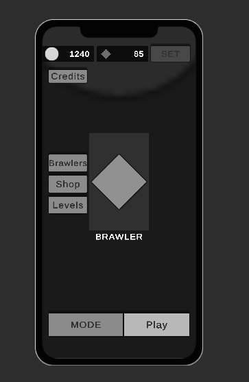 |

### Principles and techniques

- **Visual hierarchy:** Play is the only green primary action and is 960 × 190 px.
- **Thumb zone:** Play sits in the lower part of the screen.
- **Grouping:** coin and gem pills sit at the top-left; Settings is at the top-right; Brawlers and Shop are grouped as secondary actions.
- **Consistent meaning:** blue indicates a secondary/navigation action; pink is reserved for the Shop.
- **Margins:** 60 px side margins.
- **Character focus:** the Bolt hero avatar is 560 × 560 px, with a 96 px name label.
- **Information hierarchy:** “Trophies 412” is displayed below the character in 56 px yellow text.

### Tweens and motion

| What moves | Ease | Duration | Why |
|---|---|---:|---|
| Main Menu enters from Title | OutBack Fade | 0.42 s | Establishes the hub as a major destination |
| Main Menu → deeper screen | OutExpo Push | 0.38 s | Consistent forward navigation |
| Button press and release | OutCubic / OutBack | 0.08 s / 0.28 s | Gives every menu action immediate feedback |

**Navigation:** Play → Mode Select; Brawlers → Loadout; Shop → Shop; Settings → Settings. Main Menu is the navigation hub.

**Greyscale review:** Verify Play remains prominent by size, outline and text—not only by green colour. Check that the two secondary buttons remain distinguishable from the background and each other.

**Annotation callouts:** Box Play and label “960 × 190 px, primary action”; bracket Brawlers and Shop as a grouped pair; mark the currency row; show the 60 px side margin and OutExpo slide direction.

---

## 03 — Mode Select

**Purpose:** Let the player choose a game mode from three consistent, easy-to-tap cards.

### Screenshots

| Version | Image |
|---|---|
| Annotated colour | 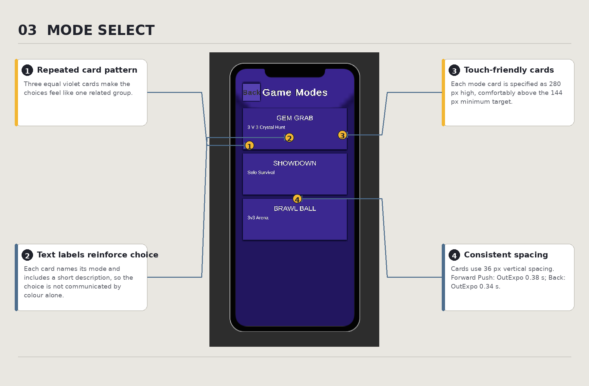 |
| Original colour | 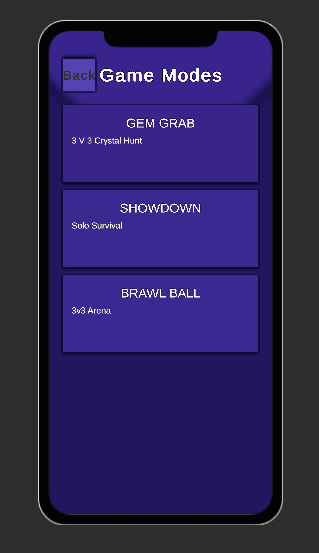 |
| Greyscale | 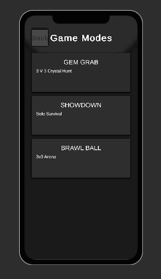 |

### Principles and techniques

- **Consistency:** three cards share the same Violet panel style and 280 px height.
- **Touch targets:** each card is 280 px high, exceeding the 144 px minimum.
- **Spacing:** cards are separated by 36 px.
- **Shape coding:** Crystal Grab uses a circle, Showdown a square, and Bounty a diamond. Mode identity is not communicated by colour alone.
- **Alignment:** mode names and descriptions share a left edge, offset 220 px from the card edge.
- **Typography:** card title 60 px; helper description 40 px Pale Lilac.
- **Grouping:** each icon, title and description belong to one card.

### Tweens and motion

| What moves | Ease | Duration | Why |
|---|---|---:|---|
| Screen slides in from the right | OutExpo | 0.38 s | Communicates forward movement from Main Menu |
| Screen slides back | OutExpo | 0.34 s | Reverses the same spatial movement |
| Card press | OutCubic / OutBack | 0.08 s / 0.28 s | Confirms the selected card |

**Navigation:** Any mode card → Level Select. Back button or Esc → previous screen.

**Greyscale review:** The three mode icons use different shapes, so their meanings remain distinguishable when hue is removed. Check that card boundaries, labels and descriptions retain sufficient value contrast.

**Annotation callouts:** Mark one 280 px card; point to the circle, square and diamond (“shape coding”); draw a vertical alignment guide through the text; label the 36 px card spacing; show the OutExpo slide direction.

---

## 04 — Level Select

**Purpose:** Let the player choose a map while showing completion progress and locked states at a glance.

### Screenshots

| Version | Image |
|---|---|
| Annotated colour | 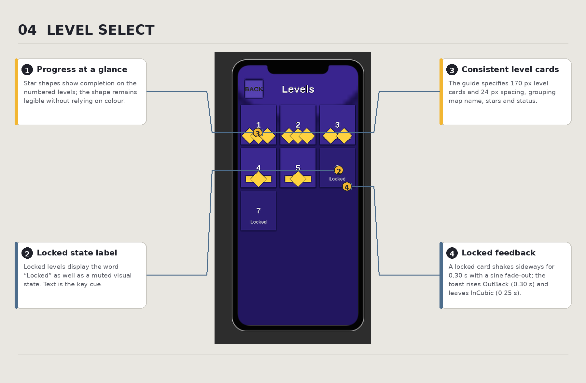 |
| Original colour | 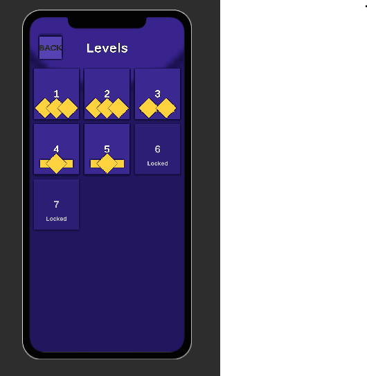 |
| Greyscale | 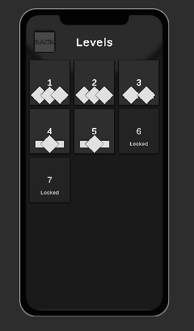 |

### Principles and techniques

- **Proximity:** each map name, star rating and lock status are grouped inside one card.
- **Consistency:** cards reuse the Violet panel pattern from Mode Select.
- **Spacing:** level cards use 24 px vertical spacing.
- **Status cues:** locked cards are dimmed to 55% alpha and display the word “Locked”.
- **Progress cues:** earned and unearned stars retain the same star shape but use different values/colours.
- **Clear feedback:** tapping a locked map produces a short shake and a toast explaining how to unlock it.
- **Primary action:** Start Match is 960 × 190 px and uses the same bottom placement as Play.

### Tweens and motion

| What moves | Ease | Duration | Why |
|---|---|---:|---|
| Screen enters / returns | OutExpo | 0.38 s / 0.34 s | Keeps navigation consistent |
| Locked card shakes | Linear progress with sine oscillation and fade-out | 0.30 s | Communicates unavailable state without a harsh error |
| Toast rises into view | OutBack | 0.30 s | Makes the explanation noticeable |
| Toast leaves | InCubic | 0.25 s | Removes feedback quickly after it has been read |
| Start Match transition | OutBack Fade | 0.42 s | Marks the jump to the gameplay placeholder |

The locked-card shake uses a 22 px horizontal distance and two back-and-forth swings. The toast remains visible for 1.4 seconds between entrance and exit.

**Navigation:** Unlocked level → Loadout. Start Match → Gameplay placeholder. Back → Mode Select. Locked levels remain on the screen and show feedback.

**Greyscale review:** Locked cards must remain identifiable through the “Locked” label and reduced opacity, not just a different colour. Earned and unearned stars must remain distinguishable by value and any supporting state treatment.

**Annotation callouts:** Bracket the map name and stars; point to a locked card and label “55% alpha + Locked + shake”; box Start Match and note 960 × 190 px; draw the shake direction and OutBack/InCubic toast sequence.

---

## 05 — Loadout

**Purpose:** Let players choose a brawler and compare Health, Damage and Speed before confirming the selection.

### Screenshots

| Version | Image |
|---|---|
| Annotated colour | 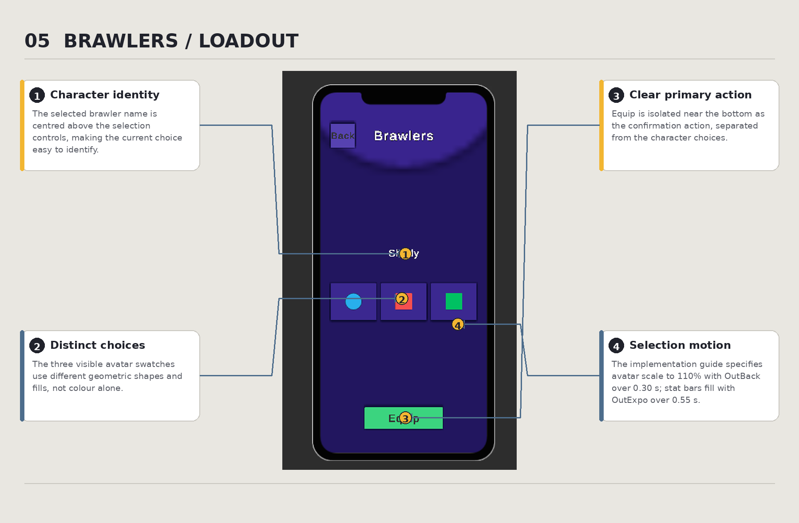 |
| Original colour | 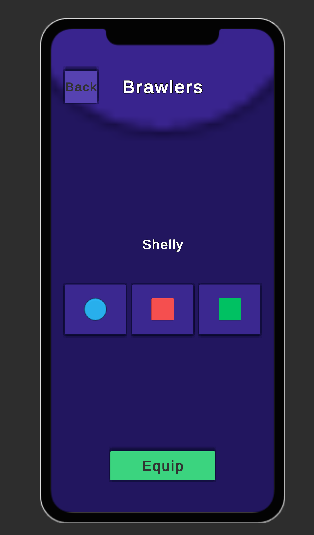 |
| Greyscale | 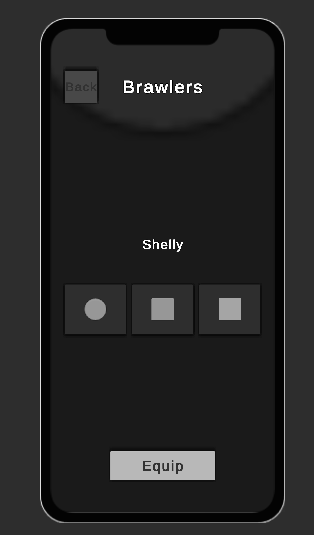 |

### Principles and techniques

- **Grid alignment:** Three character slots use a three-column grid.
- **Cell size:** 280 × 280 px.
- **Grid spacing:** 40 px horizontally and vertically.
- **One clear action:** Select is the green primary action, 960 × 190 px.

### Tweens and motion

| What moves | Ease | Duration | Why |
|---|---|---:|---|
| Selected avatar scales to 110% | OutBack | 0.30 s | Confirms which character is selected |
| Health, Damage and Speed bars fill to the selected brawler's values | OutExpo | 0.55 s | Makes stat differences easy to compare |
| Screen navigation | OutExpo | 0.38 s forward / 0.34 s back | Maintains consistent spatial navigation |
| Button press and release | OutCubic / OutBack | 0.08 s / 0.28 s | Confirms touch input |

**Navigation:** Loadout can be opened directly from Main Menu or from Level Select. Select returns to the previous screen; Back also returns to the previous screen.

**Greyscale review:** The selection ring and avatar scale must both identify the selected brawler. Stat bars need readable labels and a visible filled/unfilled difference; do not rely on bar colour alone.

**Annotation callouts:** Box the ring and enlarged avatar (“two selection cues”); bracket the three stat bars; mark the 3-column grid and 40 px gaps; show the 0.30 s avatar scale and 0.55 s stat fill.

---

## 06 — Shop

**Purpose:** Let the player browse demo offers, spend gems where required and receive clear purchase feedback.

### Screenshots

| Version | Image |
|---|---|
| Annotated colour | 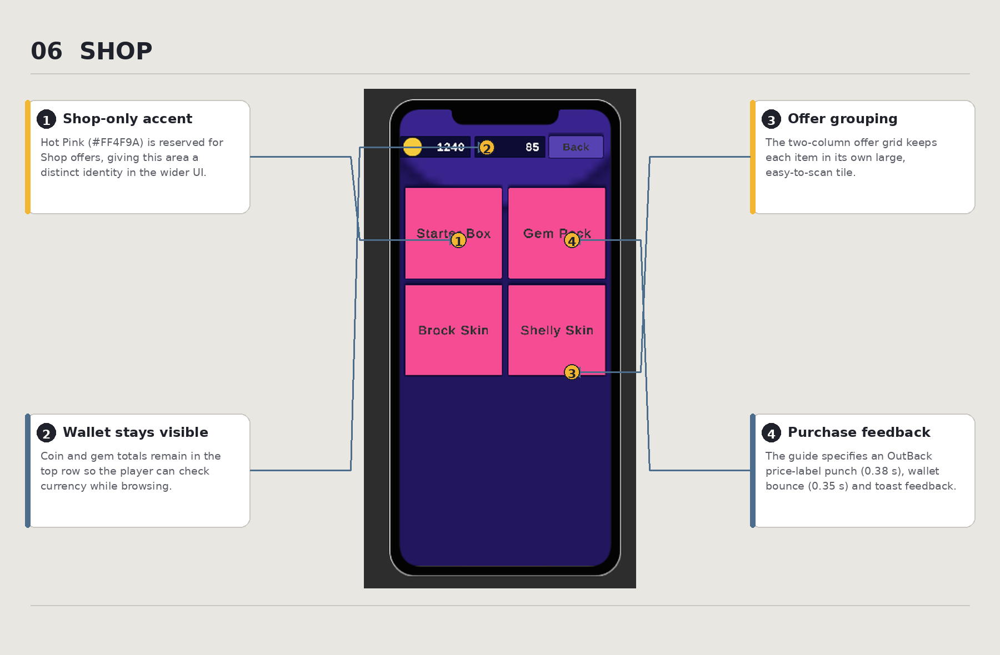 |
| Original colour | 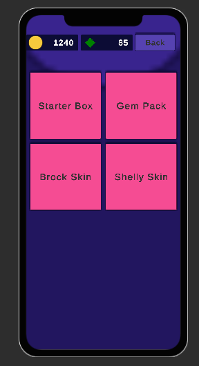 |
| Greyscale | 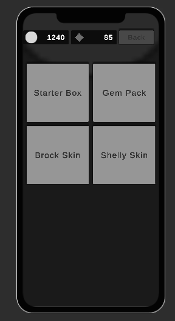 |

### Principles and techniques

- **Purposeful colour:** Hot Pink `#FF4F9A` is reserved for Shop elements.
- **Grouping:** each offer is a card containing its name, description and purchase action.
- **Visible currency:** coin and gem pills remain in the wallet row at the top.
- **Affordance:** the price is displayed on the purchase button itself.
- **Feedback and error recovery:** successful purchases show “Purchased!”; insufficient gems produce an explanatory message.
- **Owned state:** one-time purchases change the price label to “Owned” and disable the button.
- **Demo offers:** Starter Box grants 500 coins for free once; Gem Pack grants 80 gems and can be bought again; Chrome Skin costs 85 gems and can be bought once.

### Tweens and motion

| What moves | Ease | Duration | Why |
|---|---|---:|---|
| Purchase price label punch | OutBack | 0.38 s | Directs attention to the changed offer state |
| Currency pill bounce | OutBack | 0.35 s | Makes the wallet update noticeable |
| Toast entrance | OutBack | 0.30 s | Confirms the action |
| Toast exit | InCubic | 0.25 s | Clears the message without blocking the shop |
| Screen navigation | OutExpo | 0.38 s forward / 0.34 s back | Keeps the Shop connected to the menu flow |

The price label punch scales from 130% back to 100%. Currency labels bounce from 125% back to 100%.

**Navigation:** Back → Main Menu. Buy buttons update the wallet and offer state; they do not leave the Shop.

**Greyscale review:** Pink is a brand accent, not the only signal that an item belongs to the Shop. Card borders, price labels, offer names and button labels remain visible in greyscale. The Owned state must be communicated by both its text and disabled interaction state.

**Annotation callouts:** Point to a pink shop button (“Shop-only accent”); box the wallet row; mark the “Owned” label and disabled button; draw the label-punch and wallet-bounce motion notes.

---

## 07 — Settings

**Purpose:** Present preference controls in a consistent layout and provide access to Credits.

### Screenshots

| Version | Image |
|---|---|
| Annotated colour | 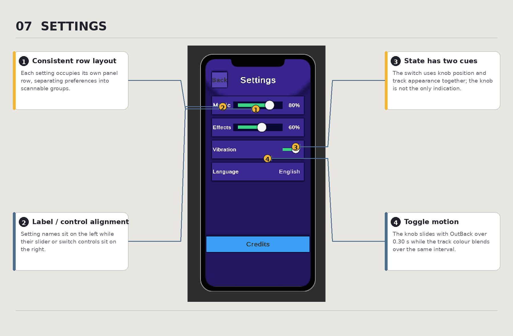 |
| Original colour | 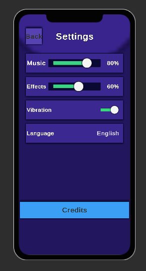 |
| Greyscale | 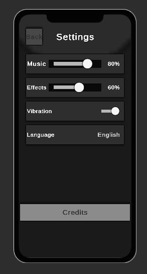 |

### Principles and techniques

- **Alignment:** labels sit on the left and controls on the right in each row.
- **Grouping:** Music, Effects, Vibration and Language each occupy a separate card row.
- **Touch targets:** setting rows are 170 px high.
- **Redundant state cues:** toggle state is represented by knob position and background colour.
- **Control dimensions:** toggle track is 180 × 96 px; knob is 80 × 80 px; travel is 84 px.
- **Separation:** Credits is a separate blue secondary action at the bottom.
- **Transparency about functionality:** this lab has no audio implementation; the switches only retain their UI state.

### Tweens and motion

| What moves | Ease | Duration | Why |
|---|---|---:|---|
| Toggle knob slides between on/off positions | OutBack | 0.30 s | Clearly communicates the changed setting |
| Toggle background blends between off/on colours | Colour lerp over the same tween | 0.30 s | Reinforces the state alongside knob position |
| Screen navigation | OutExpo | 0.38 s forward / 0.34 s back | Keeps Settings and Credits in the same navigation system |

**Navigation:** Back → Main Menu. Credits → Credits screen. Back from Credits returns to Settings.

**Greyscale review:** On/off must remain clear from knob position even if the green/off colours become similar in greyscale. Keep the labels visible and ensure the knob contrasts with the track.

**Annotation callouts:** Draw alignment guides for label and switch edges; point to the knob (“position + colour = state”); box a 170 px row; show the 0.30 s OutBack movement.

---

## 08 — Pause

**Purpose:** Pause the gameplay placeholder and offer Resume, Restart and Quit to Menu without hiding the game completely.

### Screenshots

| Version | Image |
|---|---|
| Annotated colour | 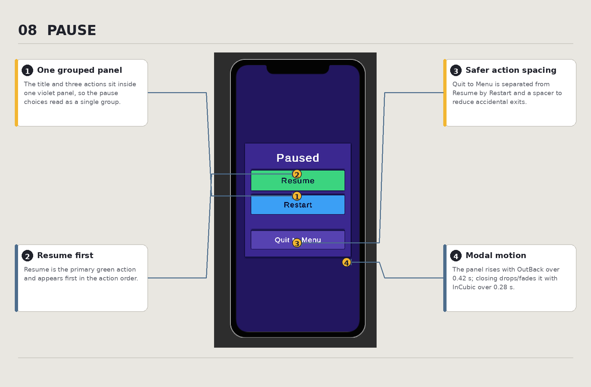 |
| Original colour | 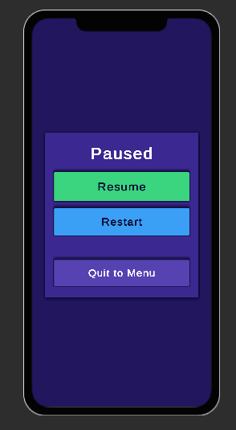 |
| Greyscale | 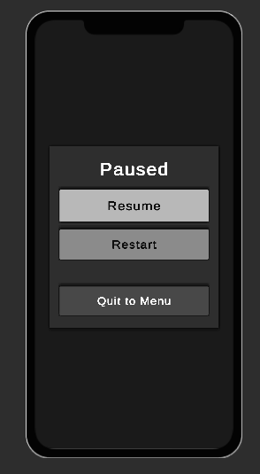 |

### Principles and techniques

- **Modal focus:** a centred Violet panel groups all pause actions.
- **Context preservation:** the underlying match remains visible through a Midnight overlay at alpha 200.
- **Action hierarchy:** Resume is the first and only green button; Restart is secondary; Quit to Menu is the quietest action.
- **Error prevention:** Quit is placed far from Resume to reduce accidental taps.
- **Panel layout:** 840 × 1000 px with 50 px padding and 36 px spacing.
- **Typography:** “Paused” is 90 px; action buttons retain large touch targets.
- **Time control:** the game timer stops while Pause is open. UI tweens continue because they use unscaled time.

### Tweens and motion

| What moves | Ease | Duration | Why |
|---|---|---:|---|
| Pause panel rises from below | OutBack | 0.42 s | Focuses attention on the modal |
| Dim layer fades in | Alpha fade | During 0.42 s opening | Separates the panel from gameplay while preserving context |
| Pause panel drops and fades out | InCubic | 0.28 s | Clears the modal quickly on resume/close |
| Button press and release | OutCubic / OutBack | 0.08 s / 0.28 s | Confirms the selected pause action |

**Navigation:** Resume → Gameplay placeholder; Restart → resets the timer and resumes; Quit to Menu → Main Menu. Esc opens Pause during the match and closes it when Pause is current.

**Greyscale review:** The panel must remain distinct from the underlying match through its dark overlay, panel border and text hierarchy. Resume, Restart and Quit must remain distinguishable by labels and position, not just their colours.

**Annotation callouts:** Box Resume (“primary, first action”); draw a double arrow between Resume and Quit (“separated to prevent accidental quit”); label the Midnight overlay alpha 200; show the panel's 0.42 s rise and 0.28 s close.

---

## 09 — Results

**Purpose:** Celebrate the match outcome, show earned rewards and offer a clear next step.

### Screenshots

| Version | Image |
|---|---|
| Annotated colour | 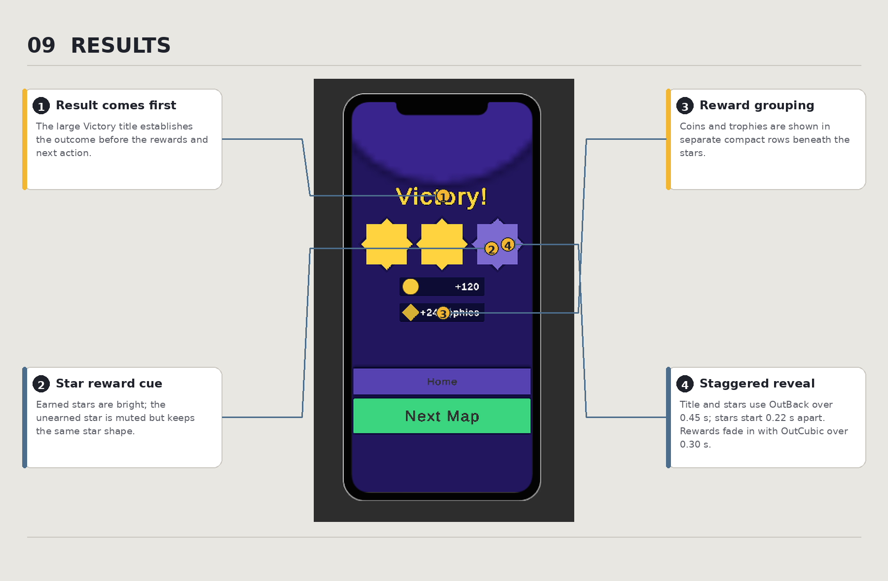 |
| Original colour | 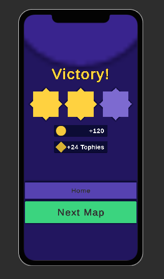 |
| Greyscale | 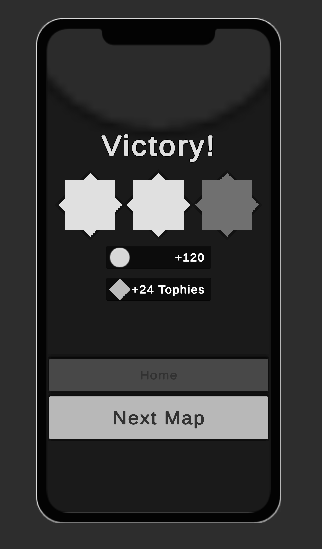 |

### Principles and techniques

- **Sequential hierarchy:** the Victory title appears first, followed by stars, then reward pills.
- **Reward clarity:** stars show performance; reward pills show +120 coins and +24 trophies.
- **State without colour alone:** the unearned third star remains visible as a star shape but uses a muted value.
- **Consistent action placement:** Next Map is the primary green action in the same bottom region used by Play and Start Match.
- **Two explicit exits:** Home returns to Main Menu; Next Map returns to Level Select.
- **Typography:** Victory title is 130 px Sun Yellow with outline.
- **Star sizing:** each star is scaled to approximately 200 px.

### Tweens and motion

| What moves | Ease | Duration | Why |
|---|---|---:|---|
| Victory title scales in | OutBack | 0.45 s | Establishes the result first |
| Each earned star scales in | OutBack | 0.45 s each | Celebrates performance one star at a time |
| Delay between star starts | Sequential stagger | 0.22 s | Creates a readable reward sequence |
| Reward pills fade in | OutCubic | 0.30 s | Reveals numerical rewards after the stars |
| Results screen transition | OutBack Fade | 0.42 s | Makes the result feel like a major state change |

**Navigation:** Next Map → Level Select (rewind); Home → Main Menu (clears history). Results ignores the generic Back key and uses these explicit actions.

**Greyscale review:** The title, stars and reward pills should remain separated by size, position and outline. The unearned star must remain visible as a shape and have a distinguishable grey value. Buttons must remain readable from labels and outlines.

**Annotation callouts:** Number the title, stars and rewards in reveal order; point to the muted third star (“unearned state”); box Next Map (“primary action, consistent bottom position”); draw the 0.22 s stagger note.

---

## 10 — Credits

**Purpose:** Credit the developer and acknowledge the visual style reference.

### Screenshots

| Version | Image |
|---|---|
| Annotated colour | 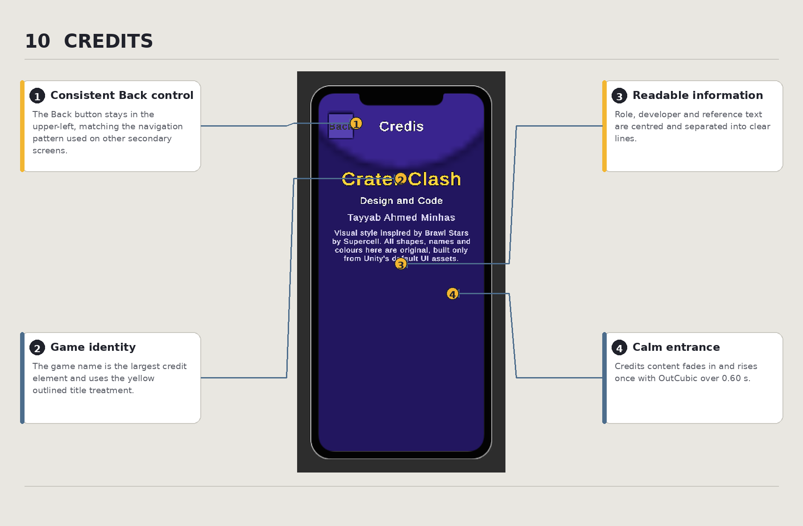 |
| Original colour | 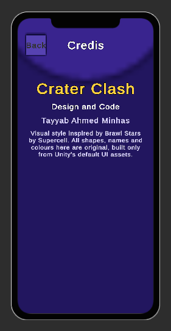 |
| Greyscale | 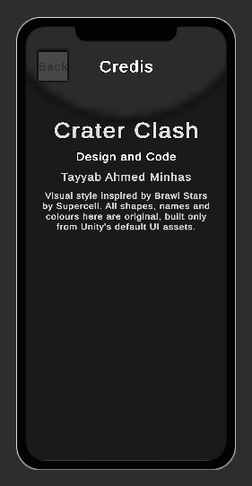 |

### Principles and techniques

- **Centred composition:** the credit content uses a centred vertical layout.
- **Readable type:** game name 110 px; role and developer name 56 px; reference note 44 px.
- **Generous spacing:** 36 px vertical spacing and 100 px top padding within the content layout.
- **Consistency:** Back remains in the same top-left position used by other secondary screens.
- **Attribution:** the screen identifies Brawl Stars by Supercell as the style inspiration and states that the game's own names, layout, colours and shapes are original.

### Tweens and motion

| What moves | Ease | Duration | Why |
|---|---|---:|---|
| Credits content fades in and rises 60 px | OutCubic | 0.60 s | Provides a calm entrance for supporting information |
| Screen opens from Settings | OutExpo | 0.38 s | Preserves the shared navigation language |
| Back navigation | OutExpo | 0.34 s | Reverses the transition consistently |

**Navigation:** Back → Settings; Back again → Main Menu.

**Greyscale review:** Confirm the game name, developer name and reference note remain readable through size, weight and spacing. The Back button should remain distinguishable by its outline, label/symbol and consistent placement.

**Annotation callouts:** Box the Back control (“same corner as other screens”); call out the 44 px reference text; mark the 36 px vertical spacing; draw the 60 px fade-up movement and label OutCubic.

---

# Responsive layout and accessibility

## Canvas configuration

| Setting | Value |
|---|---|
| Canvas | `MenuCanvas` |
| Render Mode | Screen Space — Overlay |
| Canvas Scaler | Scale With Screen Size |
| Reference Resolution | 1080 × 1920 |
| Screen Match Mode | Match Width Or Height |
| Match | 0.5 |
| Safe area | `SafeArea` component on each screen's `Safe` child |
| UI text | TextMeshPro |

The Safe Area component adjusts anchors to `Screen.safeArea`, keeping important UI away from notches and rounded screen corners. Anchors, pivots and layout groups are used to adapt the layout to different display dimensions.# CRATER CLASH
